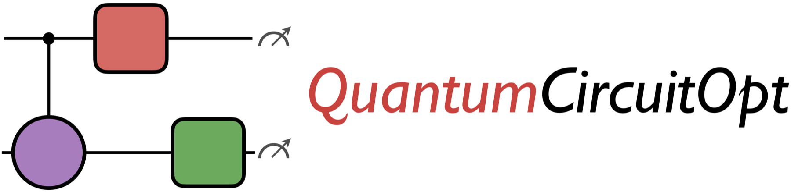

<h1 align="center">
  <picture>
    <source media="(prefers-color-scheme: dark)" srcset="docs/src/assets/logo_header_dark.png">
    
  </picture>
  <br>
  Hardware-Aware Optimal Quantum Circuit Compiler
</h1>

[](https://github.com/harshangrjn/QuantumCircuitOpt.jl/actions/workflows/ci.yml)
[](https://harshangrjn.github.io/QuantumCircuitOpt.jl/dev/)
[](https://codecov.io/gh/harshangrjn/QuantumCircuitOpt.jl/branch/master)
[](https://github.com/harshangrjn/QuantumCircuitOpt.jl/releases/latest)

**QuantumCircuitOpt.jl** is an open-source Julia/JuMP framework for hardware-aware, _provably optimal quantum circuit compilation_. Given a target quantum operation arising from a quantum algorithm or subroutine, specified by its unitary, and a user-defined set of elementary gates and allowed qubit interactions, the package synthesizes exact/optimal (including equivalence up to global phase) or approximate quantum circuit implementations. Using mixed-integer and discrete optimization, it can certify optimality for objectives such as circuit depth and resource counts, including CNOT and T gates.

QuantumCircuitOpt supports single-, two-, and multi-qubit gates, including global rotations native to atomic quantum computing platforms. The framework enables researchers, quantum compiler developers, and hardware designers to evaluate native gate sets, benchmark heuristic circuit-synthesis algorithms, and explore resource-efficient implementations of quantum operations. Its mathematical optimality guarantees provide rigorous benchmarks for both near-term and fault-tolerant quantum computing.

## Installation

QuantumCircuitOpt requires Julia 1.10 or later. It is a registered package and
can be installed by entering the following in the Julia REPL:

```julia
import Pkg
Pkg.add("QuantumCircuitOpt")
```

## Quick start

The following example decomposes a two-qubit controlled-Z gate using CNOT and
discretized U3 gates:

```julia
import QuantumCircuitOpt as QCOpt
using Gurobi
using JuMP

params = Dict{String,Any}(
    "num_qubits" => 2,
    "maximum_depth" => 4,
    "elementary_gates" => ["U3_1", "U3_2", "CNot_1_2", "Identity"],
    "target_gate" => ComplexF64[
        1 0 0 0
        0 1 0 0
        0 0 1 0
        0 0 0 -1
    ],
    "objective" => "minimize_depth",
    "decomposition_type" => "exact_optimal",
    "U3_θ_discretization" => -π:(π / 2):π,
    "U3_ϕ_discretization" => -π:(π / 2):π,
    "U3_λ_discretization" => -π:(π / 2):π,
)

optimizer = optimizer_with_attributes(Gurobi.Optimizer, "Presolve" => 1)
results = QCOpt.run_QCModel(params, optimizer)
```

See the [quick-start guide](https://harshangrjn.github.io/QuantumCircuitOpt.jl/dev/quickguide/)
for all circuit and model options, and the
[`examples`](https://github.com/harshangrjn/QuantumCircuitOpt.jl/tree/master/examples)
directory for additional decompositions.

## Testing

To test a development checkout:

```sh
git clone https://github.com/harshangrjn/QuantumCircuitOpt.jl.git
cd QuantumCircuitOpt.jl
julia --project=. -e 'using Pkg; Pkg.instantiate(); Pkg.test()'
```

## Video Links

For more technical details about the package, check out these video links:

- November 2022: Presentation [link](https://vimeo.com/771366943/01810daa4e) from the [Third Quantum Computing Software Workshop](https://sc22.supercomputing.org/session/?sess=sess423), held in conjunction with the International Conference on Super Computing ([SC22](https://sc22.supercomputing.org)).
- July 2022: Presentation [link](https://www.youtube.com/watch?v=OeONXwD4JJY) from the [JuliaCon 2022](https://pretalx.com/juliacon-2022/talk/KJTGC3/) conference.
- November 2021: Presentation [link](https://www.youtube.com/watch?v=sf1HJW5Vmio) from the [Second Quantum Computing Software Workshop](https://sc21.supercomputing.org/session/?sess=sess345), held in conjunction with the International Conference on Super Computing ([SC21](https://sc21.supercomputing.org)).

## Contributing

Bug reports, documentation corrections, and feature requests are welcome in the
[issue tracker](https://github.com/harshangrjn/QuantumCircuitOpt.jl/issues).

## Acknowledgement

This work was supported by Los Alamos National Laboratory's LDRD Early Career
Research award. The primary developer is
[Harsha Nagarajan](https://harshanagarajan.com)
([@harshangrjn](https://github.com/harshangrjn)).

## Citing QuantumCircuitOpt

If you find QuantumCircuitOpt useful in your work, please cite the publication(s)
most relevant to your use of the package. Our
[Research & Publications](https://harshangrjn.github.io/QuantumCircuitOpt.jl/dev/research/)
page provides a chronological overview of the research, brief descriptions,
paper links, and copyable BibTeX citations.